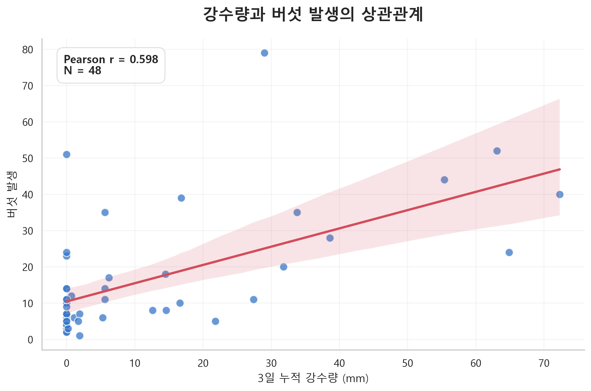
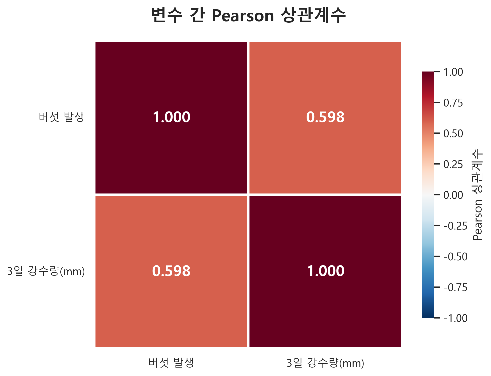
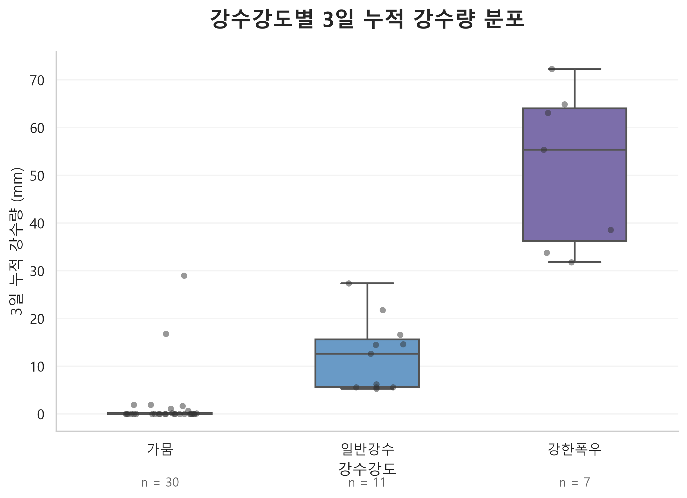

# MushRoomRepository_Brother

# 🍄 강수량과 버섯 발생의 상관관계 분석
### Rainfall and Mushroom Occurrence Analysis

## 1. 프로젝트 개요

본 프로젝트는 강수량과 버섯 발생 사이의 관계를 탐색하고, 강수강도에 따른 강수량 분포의 차이를 시각적으로 분석하기 위해 수행되었다.

버섯의 발생은 온도, 습도, 강수량, 토양 환경 등 다양한 환경적 요인의 영향을 받을 수 있다. 특히 강수는 토양 수분과 주변 습도에 영향을 미치는 요인으로, 버섯 발생과 관련된 주요 환경변수 중 하나로 고려할 수 있다.

이에 따라 본 분석에서는 **최근 3일간 누적 강수량과 버섯 발생량 사이의 선형적 관계**를 확인하고, 강수강도별 강수량 분포를 비교하였다.

### 분석 목표

1. 최근 3일 누적 강수량과 버섯 발생량 사이의 상관관계 파악
2. Pearson 상관계수를 활용한 선형적 관계의 정량적 분석
3. 산점도 및 회귀선을 통한 데이터의 분포와 변화 추세 확인
4. 강수강도별 강수량 분포의 차이 시각화
5. 분석 결과를 기반으로 버섯 발생 관련 환경변수의 활용 가능성 검토

---

## 2. 데이터 구성

### 2.1 데이터 설명

분석에는 `brother_data.xlsx` 파일을 사용하였다.

데이터는 분석 목적에 따라 두 개의 시트로 구성되어 있다.

| 시트명 | 변수 | 분석 목적 |
|--------|------|-----------|
| correlation | 버섯 발생, 3일 강수량(mm) | 강수량과 버섯 발생의 상관관계 |
| boxplot | 강수강도, 3일 강수량(mm) | 강수강도별 강수량 분포 비교 |

### 2.2 주요 변수

| 변수명 | 자료형 | 설명 |
|--------|--------|------|
| 버섯 발생 | 수치형 | 관측된 버섯 발생량 |
| 3일 강수량(mm) | 연속형 | 최근 3일간 누적 강수량 |
| 강수강도 | 범주형 | 강수 특성에 따른 분류 |

강수강도는 다음 세 가지 범주로 구성된다.

- **가뭄**: 강수량이 적은 조건
- **일반강수**: 일반적인 강수 조건
- **강한폭우**: 강수량이 많은 조건

※ 각 범주의 구체적인 강수량 기준은 원본 데이터의 분류 기준을 따른다.

---

## 3. 분석 환경

### 3.1 기술 스택

| 구분 | 기술 | 활용 목적 |
|------|------|-----------|
| Language | Python | 데이터 분석 |
| Data Processing | Pandas | 데이터 로딩 및 전처리 |
| Numerical Computing | NumPy | 수치 연산 |
| Visualization | Matplotlib | 그래프 생성 및 스타일 설정 |
| Statistical Visualization | Seaborn | 회귀선, 히트맵, 박스플롯 |
| Data Source | Excel | 원본 데이터 저장 |

### 3.2 프로젝트 구조

```text
mushroomdata/
│
├── AnalysisMushroom.py
├── brother_data.xlsx
├── README.md
│
├── output/
│   ├── 01_correlation_scatter.png
│   ├── 02_correlation_heatmap.png
│   └── 03_rainfall_boxplot.png
│
└── venv/
```

### 3.3 실행 방법

필요한 패키지 설치

```bash
pip install numpy pandas matplotlib seaborn openpyxl
```

분석 실행

```bash
python AnalysisMushroom.py
```

분석 결과는 `output/` 폴더에 PNG 파일로 저장된다.

---

## 4. 분석 방법

### 4.1 데이터 전처리

Pandas의 `read_excel()`을 사용하여 시트별 데이터를 불러왔다.

```python
correlation_data = pd.read_excel(
    "brother_data.xlsx",
    sheet_name="correlation",
    header=0
)

boxplot_data = pd.read_excel(
    "brother_data.xlsx",
    sheet_name="boxplot",
    header=0
)
```

이후 분석에 필요한 컬럼을 선택하고, 수치형 변수의 형식을 변환한 뒤 결측값을 제거하였다.

전처리 과정은 다음과 같다.

1. Excel 시트별 데이터 로딩
2. 분석에 필요한 변수 선택
3. 수치형 변수의 데이터 타입 변환
4. 결측값 제거
5. 상관관계 및 분포 분석 수행

### 4.2 Pearson 상관관계 분석

강수량과 버섯 발생량 사이의 선형적 관계를 평가하기 위해 Pearson 상관계수를 사용하였다.

Pearson 상관계수는 두 연속형 변수 사이의 선형적 관계의 방향과 강도를 나타내는 통계량이다.

상관계수의 범위는 -1부터 1까지이며, 다음과 같이 해석할 수 있다.

| 상관계수 | 일반적인 해석 |
|----------|--------------|
| -1에 가까움 | 강한 음의 선형 상관관계 |
| 0에 가까움 | 선형 상관관계가 약함 |
| 1에 가까움 | 강한 양의 선형 상관관계 |

상관계수는 다음 코드로 계산하였다.

```python
correlation_data.corr(method="pearson")
```

### 4.3 시각화 방법

분석 결과의 해석 가능성을 높이기 위해 다음 세 가지 시각화 기법을 활용하였다.

| 시각화 | 분석 목적 |
|--------|-----------|
| Scatter Plot + Regression Line | 강수량과 버섯 발생량의 관계 |
| Correlation Heatmap | 상관계수의 정량적 시각화 |
| Boxplot + Stripplot | 강수강도별 강수량 분포 비교 |

---

## 5. 분석 결과

### 5.1 강수량과 버섯 발생의 상관관계

Pearson 상관분석 결과, 최근 3일 누적 강수량과 버섯 발생량 사이에서 양의 상관관계가 확인되었다.

#### 상관계수 분석 결과

| 변수 1 | 변수 2 | Pearson r |
|--------|--------|-----------|
| 버섯 발생 | 3일 강수량(mm) | **0.5981** |

상관계수는 약 **0.598**로 나타났다.

이는 분석 데이터에서 두 변수 사이에 중간 정도의 양의 선형적 관계가 존재함을 의미한다.

즉, 강수량이 많은 관측값에서 버섯 발생량도 상대적으로 높아지는 경향이 나타난다.

다만, 상관관계는 두 변수의 연관성을 설명하는 지표이며 강수량이 버섯 발생 증가의 직접적인 원인임을 의미하지는 않는다.

### 5.2 산점도 및 회귀선 분석



3일 누적 강수량을 X축, 버섯 발생량을 Y축으로 설정하여 산점도를 작성하였다.

또한 전체적인 변화 경향을 파악하기 위해 선형 회귀선을 추가하였다.

분석에서는 다음 요소를 시각화하였다.

- 관측값의 분포
- 선형 회귀 추세선
- 회귀선의 95% 신뢰구간
- Pearson 상관계수
- 분석 표본 수

산점도와 회귀선은 강수량과 버섯 발생량의 관계를 직관적으로 확인하는 데 활용된다.

특히 Pearson 상관계수와 함께 해석하면 전체적인 선형 추세뿐 아니라 개별 관측값의 분산 정도도 함께 평가할 수 있다.

회귀선은 관측 데이터의 평균적인 추세를 나타내며, 개별 버섯 발생량을 정확하게 예측한다는 의미는 아니다.

### 5.3 상관계수 히트맵



상관계수 행렬을 히트맵으로 시각화하여 변수 사이의 관계를 비교하였다.

#### 상관계수 행렬

| 변수 | 버섯 발생 | 3일 강수량(mm) |
|------|-----------|----------------|
| 버섯 발생 | 1.0000 | 0.5981 |
| 3일 강수량(mm) | 0.5981 | 1.0000 |

히트맵에서는 상관계수의 크기와 방향을 색상으로 표현하였다.

분석 결과, 강수량과 버섯 발생량 사이의 양의 상관관계를 시각적으로 확인할 수 있었다.

두 변수만을 대상으로 분석했기 때문에 히트맵의 구조는 단순하지만, 향후 온도, 습도, 일조량 등 추가 환경변수가 확보되면 다변량 상관관계 분석으로 확장할 수 있다.

### 5.4 강수강도별 강수량 분포 분석



강수강도에 따른 3일 누적 강수량의 분포를 비교하기 위해 Boxplot을 활용하였다.

분석 대상은 다음 세 그룹이다.

1. 가뭄
2. 일반강수
3. 강한폭우

박스플롯을 통해 다음 통계적 특성을 비교할 수 있다.

- 중앙값(Median)
- 제1사분위수(Q1)
- 제3사분위수(Q3)
- 사분위 범위(IQR)
- 그룹별 관측값의 분산 정도

추가로 Stripplot을 적용하여 개별 관측값을 함께 표시하였다.

이를 통해 박스플롯만으로 확인하기 어려운 실제 데이터의 밀집 정도와 관측값 분포를 확인할 수 있도록 구성하였다.

본 분석에서 박스플롯은 강수강도의 범주별 특성을 탐색하는 용도로 사용하였다.

강수강도가 강수량을 기준으로 분류된 변수라면, 그룹 간 강수량 차이는 분류 기준에 의해 나타날 수 있으므로 이를 독립적인 통계적 발견으로 해석하지 않도록 주의해야 한다.

---

## 6. 주요 분석 결과 요약

| 분석 항목 | 분석 결과 | 해석 |
|-----------|-----------|------|
| Pearson 상관분석 | r = 0.5981 | 중간 정도의 양의 선형 상관관계 |
| 산점도 분석 | 선형 추세 시각화 | 강수량과 버섯 발생량의 관계 탐색 |
| 상관계수 히트맵 | 양의 상관계수 확인 | 변수 간 연관성 시각화 |
| 강수강도별 박스플롯 | 범주별 분포 시각화 | 중앙값 및 변동성 비교 |

### 핵심 인사이트

**1. 최근 3일 강수량은 버섯 발생량과 연관성이 있는 변수로 확인되었다.**

상관계수 0.5981은 분석 데이터에서 두 변수 사이에 일정 수준의 양의 선형관계가 존재함을 보여준다.

**2. 버섯 발생량 분석에서 강수량은 유용한 설명변수 후보가 될 수 있다.**

다만 실제 예측력을 평가하려면 별도의 예측모델 구축 및 검증 과정이 필요하다.

**3. 상관관계만으로 버섯 발생의 원인을 규명하기는 어렵다.**

버섯 발생에는 기온, 상대습도, 토양 상태 및 계절적 요인 등 다양한 변수가 복합적으로 작용할 가능성이 있다.

---

## 7. 분석의 한계점

### 7.1 단일 환경변수 중심 분석

본 분석에서는 최근 3일 누적 강수량을 주요 설명변수로 활용하였다.

하지만 버섯 발생은 다양한 환경적 요인의 영향을 받을 수 있으므로, 강수량만으로 발생 특성을 충분히 설명하기는 어렵다.

### 7.2 상관관계와 인과관계의 차이

Pearson 상관계수는 두 변수의 선형적 연관성을 측정하지만, 변수 간 인과관계를 설명하지 않는다.

따라서 강수량이 많을수록 버섯 발생량이 증가한다고 단정할 수는 없다.

### 7.3 통계적 유의성 검정 미수행

현재 분석에서는 Pearson 상관계수를 계산했으나, 상관계수에 대한 p-value와 신뢰구간 분석 결과는 별도로 제시하지 않았다.

따라서 통계적 유의성에 대한 판단은 추가 분석이 필요하다.

### 7.4 비선형 관계 검토 필요

강수량과 버섯 발생량의 관계가 항상 선형적이라고 가정하기는 어렵다.

특정 강수량 이상에서는 발생량 증가가 둔화되거나 감소할 가능성도 있으므로, 비선형 관계에 대한 추가 검토가 필요하다.

---

## 8. 향후 개선 방향

### 8.1 추가 환경변수 확보

다음과 같은 환경변수를 추가하여 다변량 분석을 수행할 수 있다.

- 평균기온 및 최고·최저기온
- 상대습도
- 토양 수분
- 일조시간
- 강수 발생 후 경과일
- 계절 및 월별 특성

### 8.2 통계 분석 고도화

단순 상관분석을 확장하여 다음 기법을 적용할 수 있다.

- Spearman 순위상관분석
- Pearson 상관계수 유의성 검정
- 단순 및 다중선형회귀
- 비선형 회귀분석
- 강수량의 시차 효과 분석

### 8.3 예측모델 구축

충분한 관측 데이터와 환경변수가 확보된다면 머신러닝을 활용한 버섯 발생량 예측모델로 확장할 수 있다.

후보 모델은 다음과 같다.

- Linear Regression
- Random Forest Regressor
- Gradient Boosting
- XGBoost

모델 성능은 MAE, RMSE, R² 등의 평가 지표를 활용하여 비교할 수 있다.

단, 시계열 구조가 존재하는 데이터라면 시간 순서를 고려한 학습 및 검증 데이터 분할이 필요하다.

---

## 9. 결론

본 프로젝트에서는 최근 3일간 누적 강수량과 버섯 발생량 사이의 관계를 탐색적으로 분석하였다.

Pearson 상관분석 결과 **r = 0.5981**의 양의 상관계수가 확인되었으며, 이는 강수량과 버섯 발생량 사이에 중간 정도의 양의 선형적 관계가 존재함을 보여준다.

또한 산점도, 회귀선 및 상관계수 히트맵을 통해 변수 간 연관성을 시각화하고, 박스플롯을 활용하여 강수강도별 강수량 분포를 비교하였다.

본 분석은 강수량이 버섯 발생과 관련된 주요 환경변수 후보임을 확인하는 탐색적 분석으로 의미가 있다.

향후 다양한 기상 및 환경변수를 추가하고 통계적 유의성 검정과 예측모델 평가를 수행한다면, 보다 체계적인 버섯 발생 특성 분석 및 예측 연구로 확장할 수 있을 것으로 기대된다.
